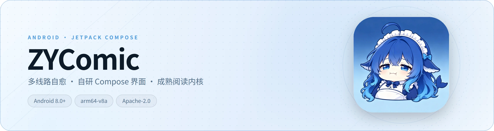
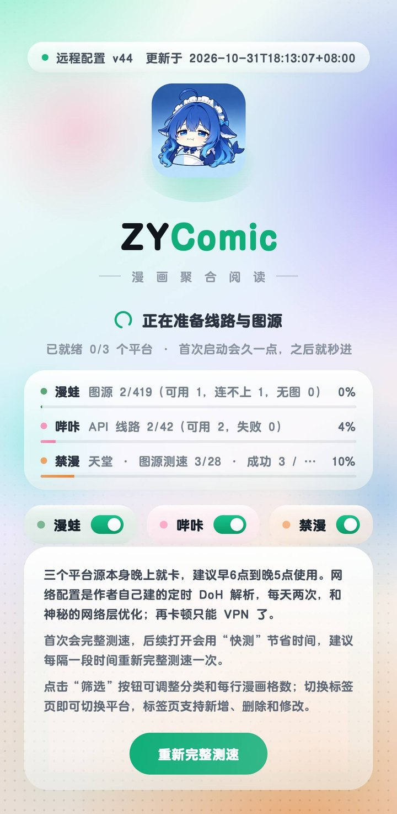
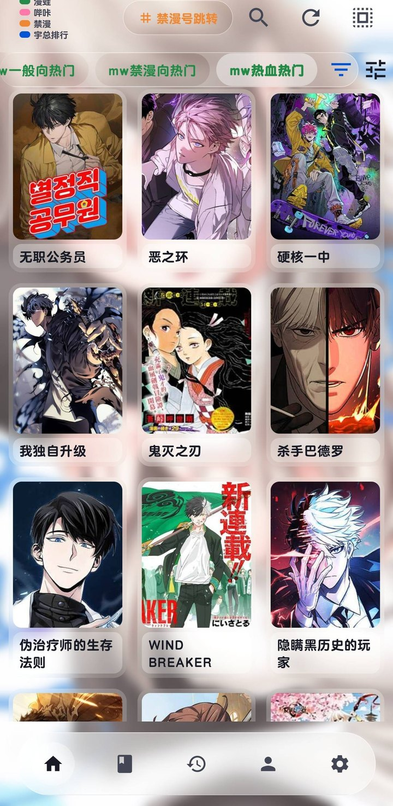
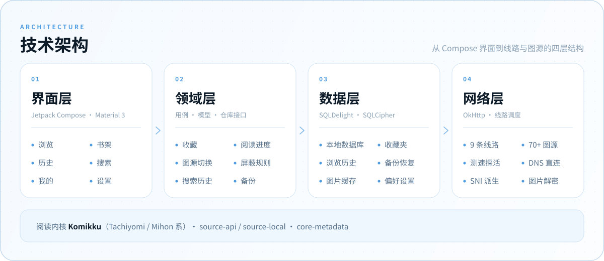

<div align="center">

<picture>
  <source media="(prefers-color-scheme: dark)" srcset="./.github/readme-images/banner-dark.webp">
  <source media="(prefers-color-scheme: light)" srcset="./.github/readme-images/banner-light.webp">
  
</picture>

<br>
<br>

<a href="https://github.com/fuoins/ZYComic-Android/releases/latest"></a>&nbsp;&nbsp;&nbsp;&nbsp;<a href="https://github.com/fuoins/ZYComic-Android/releases"></a>&nbsp;&nbsp;&nbsp;&nbsp;<a href="https://github.com/fuoins/ZYComic-Android/issues"></a>

<br>
<br>


<br>
<br>

</div>

> **ZYComic** 是一款 Android 在线漫画阅读器：自研 Jetpack Compose 界面，复用 komikku 阅读器内核，内置线路调度与图源管理。从发现到阅读，都在同一个界面里完成。

<p align="center">
  <a href="#亮点">亮点</a> ·
  <a href="#功能一览">功能</a> ·
  <a href="#技术架构">架构</a> ·
  <a href="#下载">下载</a> ·
  <a href="#从源码构建">构建</a> ·
  <a href="#开源与致谢">许可</a>
</p>

---

<table>
  <tr>
    <td width="33%" valign="top">
      <b>01 · 线路会自己挑</b><br><br>
      9 条线路、70+ 图源、80+ 条 DNS 直连规则。启动自动测速并按延迟排序，线路异常时自动切换；线路与规则支持远程更新。
    </td>
    <td width="33%" valign="top">
      <b>02 · 界面是自研的</b><br><br>
      浏览 / 书架 / 历史 / 搜索 / 我的五个页签，统一三列封面网格；深浅色、自定义主色、标签与单本屏蔽都能自己调。
    </td>
    <td width="33%" valign="top">
      <b>03 · 内核是成熟的</b><br><br>
      阅读器来自 komikku（Tachiyomi / Mihon 系）：条漫滚动、左右翻页、双页、缩放，以及阅读方向与导航区自定义。
    </td>
  </tr>
</table>

## 界面预览

<p align="center">
  
  &nbsp;&nbsp;&nbsp;
  
</p>

<p align="center"><sub>左：启动时自动测速、逐平台准备线路　·　右：分类标签切换，三列封面网格</sub></p>

## 功能一览

| 模块 | 能做什么 |
| :--- | :--- |
| **浏览** | 排行榜、最近更新、分类标签；三列封面网格，支持筛选与单本屏蔽 |
| **书架** | 收藏夹管理、追更列表，封面标记连载 / 完结状态 |
| **历史** | 记录阅读进度，单条删除与多选清理，随时续读 |
| **搜索** | 关键词搜索、搜索历史、列表视图切换 |
| **我的** | 账号信息、标签屏蔽、漫画屏蔽、外观与阅读设置 |
| **阅读器** | 条漫 / 左右翻页 / 双页 / 缩放，导航区与阅读方向可调 |

## 技术架构

<picture>
  <source media="(prefers-color-scheme: dark)" srcset="./.github/readme-images/architecture-dark.svg">
  <source media="(prefers-color-scheme: light)" srcset="./.github/readme-images/architecture-light.svg">
  
</picture>

界面与业务编排放在 `app`，`domain` 收敛用例，`data` 用 SQLCipher 加密落库；网络层由 `RouteManager` 统一管理线路、图源与 DNS 直连，加密图片在客户端解密后交给阅读器。阅读器直接复用 komikku 的成熟实现，不重复造轮子。

**技术栈**：`Kotlin` · `Jetpack Compose` · `Material 3` · `Voyager` · `Coil 3` · `SQLDelight + SQLCipher` · `OkHttp / Retrofit` · `Injekt`

<details>
<summary><b>模块说明</b></summary>

<br>

| 模块 | 职责 |
| :--- | :--- |
| `app` | Compose 界面、底部导航、DI、Worker |
| `domain` | 用例、数据模型、仓库接口 |
| `data` | SQLDelight + SQLCipher 数据库、仓库实现 |
| `core:common` | 网络、安全、存储等基础设施 |
| `core:archive` | CBZ 等压缩包读取 |
| `core-metadata` | 漫画元数据解析 |
| `source-api` / `source-local` | 图源接口与本地图源 |
| `presentation-core` | 共享 Compose 组件 |
| `i18n` / `i18n-kmk` / `i18n-sy` | 多语言资源（Moko Resources） |

</details>

## 下载

**最新版本 v6.0.0**（2026-10-28）· 约 41.5 MB · 仅 64 位 ARM 设备

| 文件 | 适用设备 | 大小 |
| :--- | :--- | ---: |
| [ZYComic-6.0.0-arm64-v8a.apk](https://github.com/fuoins/ZYComic-Android/releases/download/v6.0.0/ZYComic-6.0.0-arm64-v8a.apk) | Android 8.0+ · arm64-v8a | 41.5 MB |

1. 下载 APK 到手机；
2. 在浏览器或文件管理器中允许「安装未知应用」；
3. 安装后首次启动会进行线路与图源测速，等待完成即可开始阅读。

> 正式包使用 release 签名。若此前装过未签名的测试版（同包名 `com.zycomic.app`），请先卸载再安装。调试版 `com.zycomic.app.dev` 使用独立包名，可共存。

## 从源码构建

**环境要求**：JDK 17、Android SDK Platform 36；Gradle 由 Wrapper 提供。

```bash
git clone --recursive https://github.com/fuoins/ZYComic-Android.git
cd ZYComic-Android
./gradlew assembleRelease
```

产物位于 `app/build/outputs/apk/release/`。未注入签名配置时产物为**未签名** APK，需要自行签名后再分发。

仓库内置两条 GitHub Actions 流程：

| 流程 | 触发方式 | 说明 |
| :--- | :--- | :--- |
| Build APK | 手动触发 | `quick` 快速构建 / `final` 开启 R8 与资源压缩 |
| Release APK | 推送 `v*` 标签 | 签名构建并创建草稿 Release，上传 APK |

## 开源与致谢

ZYComic 以 **Apache License 2.0** 开源，详见 [LICENSE](./LICENSE)。

阅读器内核与部分 UI 框架来自开源项目 **komikku**（其又源自 TachiyomiSY 与 Mihon / Tachiyomi），相关代码同样遵循 Apache License 2.0。项目已保留上游版权声明与许可文件；本项目与 komikku / Tachiyomi / Mihon 无官方关联，亦不使用其商标。各依赖库的版权与许可见其各自仓库及应用内「关于」页。

> **免责声明**：本项目仅用于 Android 开发技术学习与交流，不提供、不托管、不分发任何漫画内容；应用内展示的内容均来自第三方接口，版权归原作者及相应平台所有。请勿用于商业用途，并在试用后 24 小时内删除。

---

<div align="center">
  <sub>基于 Kotlin 与 Jetpack Compose 构建 · Apache-2.0 · © 2026 fuoins</sub>
</div>
